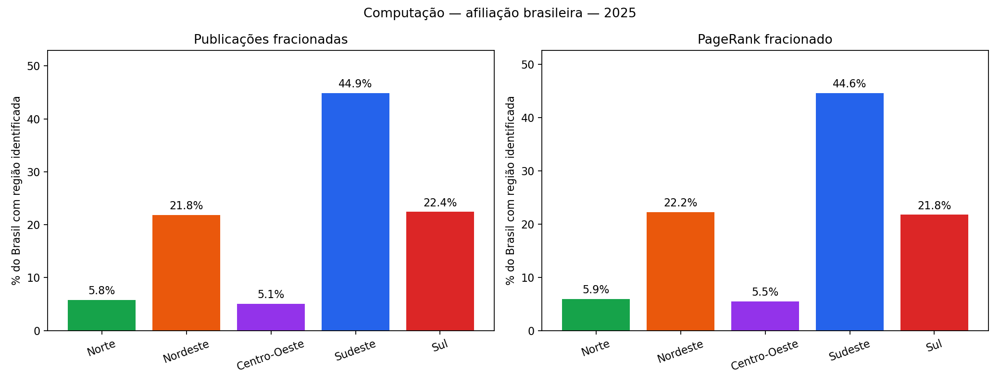
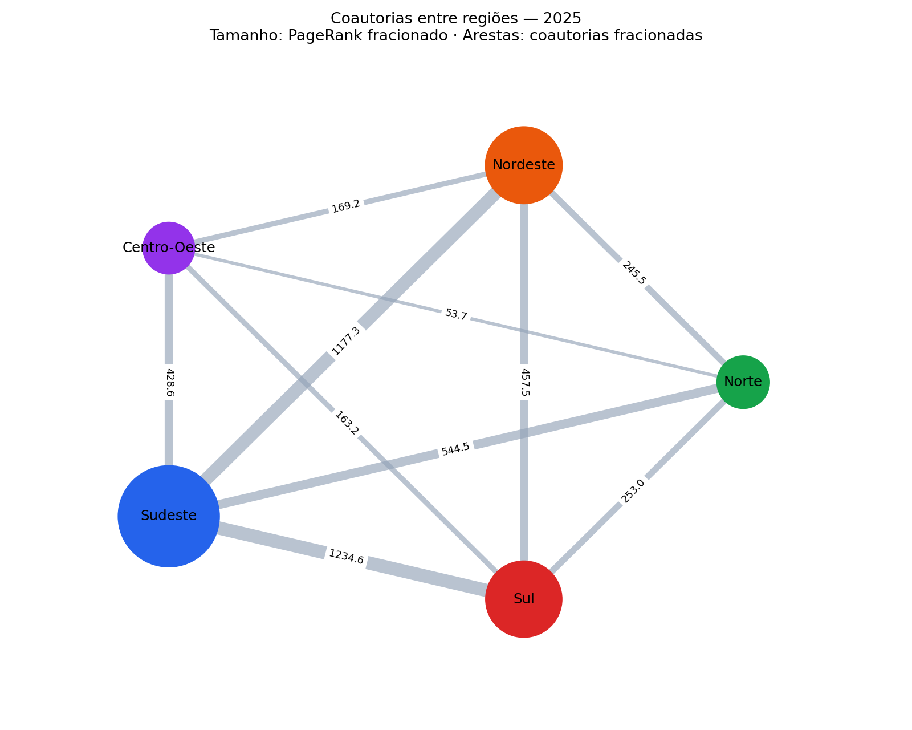

# Resultados — Computação no Brasil — 2025

## Recorte

| Parâmetro | Valor |
| --- | --- |
| Ano | 2025 |
| Campo OpenAlex | Computer Science (17) |
| País de afiliação | BR |
| Tipos retidos | article, conference-paper, review |
| Geografia | UF da sede da instituição informada na autoria |
| Contagem regional | Fracionada entre regiões brasileiras distintas |
| Domínio das centralidades | Rede completa, incluindo coautores externos |
| Domínio do autovetor | Maior componente |

## Estatísticas

| Estatística | Valor |
| --- | --- |
| Publicações recebidas | 9666 |
| Publicações retidas | 8295 |
| Publicações excluídas | 1371 |
| Autores identificados | 20840 |
| Isolados removidos da rede | 363 |
| Nós | 20477 |
| Arestas | 69154 |
| Densidade | 0.000330 |
| Grau médio | 6.754310 |
| Agrupamento médio não ponderado | 0.809578 |
| Componentes conectadas | 2185 |
| Nós na maior componente | 9330 |
| Autores com afiliação brasileira na rede | 14989 |
| Autores com múltiplas regiões brasileiras | 189 |

## Distribuição por região

| Região | Autores fracionados | Publicações fracionadas | % publicações BR classificado | PageRank fracionado | % PageRank BR classificado | Agrupamento médio dos autores |
| --- | --- | --- | --- | --- | --- | --- |
| Norte | 833.583333 | 463.900000 | 5.79% | 0.042839 | 5.91% | 0.771867 |
| Nordeste | 3222.583333 | 1748.816667 | 21.83% | 0.161058 | 22.24% | 0.773844 |
| Centro-Oeste | 791.166667 | 406.316667 | 5.07% | 0.039603 | 5.47% | 0.785564 |
| Sudeste | 6467.250000 | 3595.733333 | 44.88% | 0.323236 | 44.63% | 0.772340 |
| Sul | 3163.583333 | 1796.816667 | 22.43% | 0.157569 | 21.75% | 0.762094 |

## Eixos regionais

| Eixo | Autores fracionados | Publicações fracionadas | % publicações BR classificado | PageRank fracionado | % PageRank BR classificado |
| --- | --- | --- | --- | --- | --- |
| Sudeste + Sul | 9630.833333 | 5392.550000 | 67.31% | 0.480805 | 66.38% |
| Norte + Nordeste | 4056.166667 | 2212.716667 | 27.62% | 0.203897 | 28.15% |
| Centro-Oeste | 791.166667 | 406.316667 | 5.07% | 0.039603 | 5.47% |

## Cobertura geográfica complementar

| Categoria | Autores fracionados | Publicações fracionadas | PageRank fracionado |
| --- | --- | --- | --- |
| Brasil sem UF | 510.833333 | 283.416667 | 0.025146 |
| Exterior | 3649.000000 | 0.000000 | 0.168519 |
| Sem afiliação identificada | 1839.000000 | 0.000000 | 0.082030 |

## Coautorias fracionadas por par de regiões

| Região 1 | Região 2 | Coautorias fracionadas |
| --- | --- | --- |
| Norte | Norte | 2394.583333 |
| Norte | Nordeste | 245.500000 |
| Norte | Centro-Oeste | 53.750000 |
| Norte | Sudeste | 544.541667 |
| Norte | Sul | 253.041667 |
| Nordeste | Nordeste | 8324.250000 |
| Nordeste | Centro-Oeste | 169.166667 |
| Nordeste | Sudeste | 1177.291667 |
| Nordeste | Sul | 457.541667 |
| Centro-Oeste | Centro-Oeste | 2150.583333 |
| Centro-Oeste | Sudeste | 428.583333 |
| Centro-Oeste | Sul | 163.166667 |
| Sudeste | Sudeste | 16678.875000 |
| Sudeste | Sul | 1234.583333 |
| Sul | Sul | 8181.458333 |

## Métricas por autor — Top 10 por PageRank — afiliação brasileira

| Posição | Autor ID | Pesquisador | Regiões | Grau | Força | PageRank ponderado (α = 0,85) | Agrupamento local não ponderado | Autovetor ponderado (maior componente) |
| --- | --- | --- | --- | --- | --- | --- | --- | --- |
| 1 | https://openalex.org/A5076776322 | Joel J. P. C. Rodrigues | Nordeste \| Norte | 108 | 149 | 0.00081221 | 0.043268 | 1.0616778e-09 |
| 2 | https://openalex.org/A5080739504 | Arlindo Rodrigues Galvão Filho | Centro-Oeste | 70 | 102 | 0.00047582 | 0.079917 | 3.7401755e-09 |
| 3 | https://openalex.org/A5055821345 | Christian Esteve Rothenberg | Sudeste | 63 | 144 | 0.00045220 | 0.099846 | 2.5760018e-10 |
| 4 | https://openalex.org/A5088960174 | Diego Kreutz | Sul | 57 | 101 | 0.00044891 | 0.082707 | 2.9083501e-08 |
| 5 | https://openalex.org/A5014448875 | Anselmo Cardoso de Paiva | Nordeste | 56 | 102 | 0.00040310 | 0.108442 | 2.1619755e-12 |
| 6 | https://openalex.org/A5046370637 | Marcos André Gonçalves | Sudeste \| Sul | 55 | 100 | 0.00038267 | 0.118519 | 7.2964861e-09 |
| 7 | https://openalex.org/A5043147904 | Anderson De Rezende Rocha | Sudeste | 43 | 58 | 0.00038177 | 0.084164 | 4.2953478e-13 |
| 8 | https://openalex.org/A5075995933 | Luiz Rodrigues | Nordeste \| Sudeste \| Sul | 53 | 89 | 0.00038066 | 0.144412 | 8.2276452e-05 |
| 9 | https://openalex.org/A5003275797 | João Paulo Papa | Sudeste | 59 | 71 | 0.00037697 | 0.088252 | 2.1797162e-12 |
| 10 | https://openalex.org/A5025630415 | Rafael Ferreira Mello | Nordeste | 58 | 88 | 0.00037360 | 0.120387 | 8.1840297e-05 |

## Tipos de publicação retidos

| Tipo | Publicações |
| --- | --- |
| article | 3658 |
| conference-paper | 4502 |
| review | 135 |

## Auditoria

| Registro | Quantidade |
| --- | --- |
| autorias_recuperadas_por_orcid | 534 |
| autorias_sem_identificador | 3865 |
| autorias_truncadas_na_fonte | 6 |
| id_ou_doi_duplicado | 1 |
| registros_recebidos | 9666 |
| sem_autores_identificaveis | 235 |
| tipo_book | 39 |
| tipo_book-chapter | 213 |
| tipo_book-review | 9 |
| tipo_conference-abstract | 26 |
| tipo_data-paper | 9 |
| tipo_dataset | 87 |
| tipo_dissertation | 54 |
| tipo_editorial | 50 |
| tipo_erratum | 14 |
| tipo_other | 58 |
| tipo_paratext | 5 |
| tipo_peer-review | 14 |
| tipo_preprint | 480 |
| tipo_report | 14 |
| tipo_retraction | 1 |
| tipo_software | 46 |
| tipo_software-paper | 6 |
| tipo_supplementary-materials | 4 |

## Distribuição regional

## Colaboração regional

## Distribuição de grau

