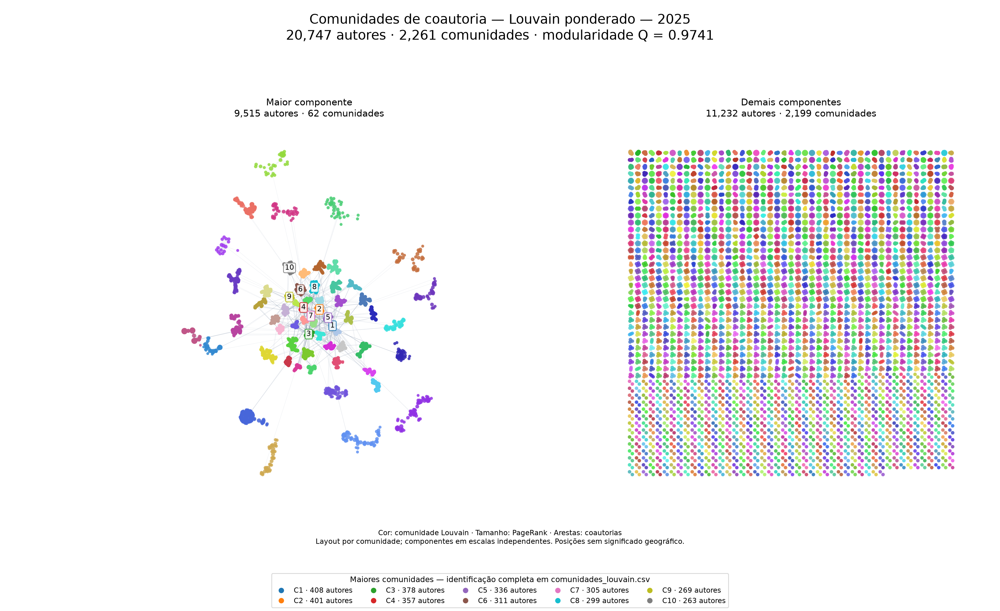
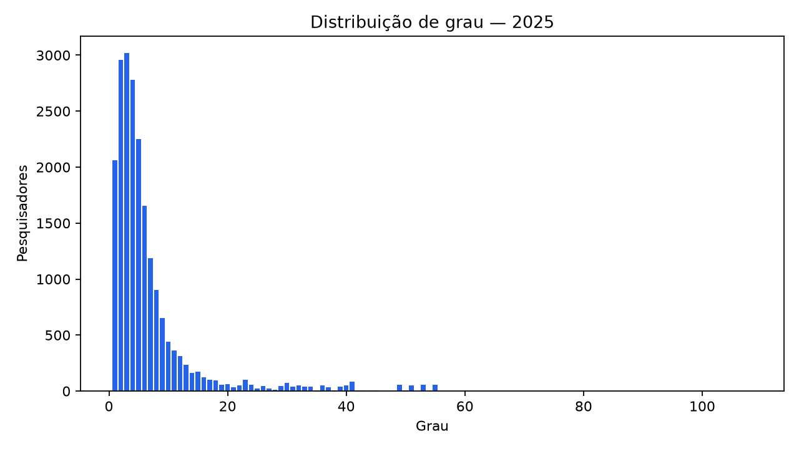

# Resultados — Computação no Brasil — 2025

## Recorte

| Parâmetro | Valor |
| --- | --- |
| Ano | 2025 |
| Campo OpenAlex | Computer Science (17) |
| País de afiliação | BR |
| Tipos retidos | article, conference-paper, review |
| Geografia | UF da sede da instituição informada na autoria |
| Contagem regional | Fracionada entre regiões brasileiras distintas |
| Domínio das centralidades | Rede completa, incluindo coautores externos |
| Domínio do autovetor | Maior componente |

## Estatísticas

| Estatística | Valor |
| --- | --- |
| Publicações recebidas | 9775 |
| Publicações retidas | 8396 |
| Publicações excluídas | 1379 |
| Autores identificados | 21112 |
| Isolados removidos da rede | 365 |
| Nós | 20747 |
| Arestas | 69938 |
| Densidade | 0.000325 |
| Grau médio | 6.741987 |
| Agrupamento médio não ponderado | 0.809804 |
| Componentes conectadas | 2200 |
| Nós na maior componente | 9515 |
| Comunidades Louvain | 2261 |
| Modularidade ponderada Louvain | 0.974110 |
| Autores com afiliação brasileira na rede | 15195 |
| Autores com múltiplas regiões brasileiras | 192 |

## Comunidades Louvain — maiores grupos

| Comunidade | Cor (hex) | Autores | Arestas internas | Peso interno |
| --- | --- | --- | --- | --- |
| 1 | #1f77b4 | 408 | 1281 | 1652.0 |
| 2 | #ff7f0e | 401 | 1150 | 1370.0 |
| 3 | #2ca02c | 378 | 1374 | 1989.0 |
| 4 | #d62728 | 357 | 1129 | 1479.0 |
| 5 | #9467bd | 336 | 1017 | 1300.0 |
| 6 | #8c564b | 311 | 1098 | 1300.0 |
| 7 | #e377c2 | 305 | 1079 | 1415.0 |
| 8 | #17becf | 299 | 902 | 1070.0 |
| 9 | #bcbd22 | 269 | 988 | 1236.0 |
| 10 | #7f7f7f | 263 | 982 | 1326.0 |

| Parâmetro Louvain | Valor |
| --- | --- |
| Rede analisada | Todos os autores com coautoria, incluindo coautores externos |
| Peso | Número de publicações conjuntas |
| Resolução | 1.0 |
| Semente | 42 |
| Todos os grupos | ../dados/limpos/comunidades_louvain.csv |
| Comunidade de cada autor | ../dados/limpos/metricas_autores.csv |

## Distribuição por região

| Região | Autores fracionados | Publicações fracionadas | % publicações BR classificado | PageRank fracionado | % PageRank BR classificado | Agrupamento médio dos autores |
| --- | --- | --- | --- | --- | --- | --- |
| Norte | 836.916667 | 465.233333 | 5.74% | 0.042439 | 5.85% | 0.770386 |
| Nordeste | 3318.250000 | 1786.983333 | 22.04% | 0.163876 | 22.60% | 0.775051 |
| Centro-Oeste | 794.500000 | 408.150000 | 5.03% | 0.039231 | 5.41% | 0.785391 |
| Sudeste | 6547.083333 | 3637.066667 | 44.85% | 0.322922 | 44.54% | 0.772663 |
| Sul | 3182.083333 | 1811.316667 | 22.34% | 0.156571 | 21.59% | 0.760925 |

## Eixos regionais

| Eixo | Autores fracionados | Publicações fracionadas | % publicações BR classificado | PageRank fracionado | % PageRank BR classificado |
| --- | --- | --- | --- | --- | --- |
| Sudeste + Sul | 9729.166667 | 5448.383333 | 67.19% | 0.479493 | 66.13% |
| Norte + Nordeste | 4155.166667 | 2252.216667 | 27.78% | 0.206315 | 28.46% |
| Centro-Oeste | 794.500000 | 408.150000 | 5.03% | 0.039231 | 5.41% |

## Cobertura geográfica complementar

| Categoria | Autores fracionados | Publicações fracionadas | PageRank fracionado |
| --- | --- | --- | --- |
| Brasil sem UF | 516.166667 | 287.250000 | 0.025062 |
| Exterior | 3662.000000 | 0.000000 | 0.166879 |
| Sem afiliação identificada | 1890.000000 | 0.000000 | 0.083020 |

## Coautorias fracionadas por par de regiões

| Região 1 | Região 2 | Coautorias fracionadas |
| --- | --- | --- |
| Norte | Norte | 2395.916667 |
| Norte | Nordeste | 245.833333 |
| Norte | Centro-Oeste | 53.750000 |
| Norte | Sudeste | 544.541667 |
| Norte | Sul | 253.041667 |
| Nordeste | Nordeste | 8609.250000 |
| Nordeste | Centro-Oeste | 169.166667 |
| Nordeste | Sudeste | 1202.625000 |
| Nordeste | Sul | 460.541667 |
| Centro-Oeste | Centro-Oeste | 2154.583333 |
| Centro-Oeste | Sudeste | 430.916667 |
| Centro-Oeste | Sul | 163.166667 |
| Sudeste | Sudeste | 16887.208333 |
| Sudeste | Sul | 1240.583333 |
| Sul | Sul | 8262.458333 |

## Métricas por autor — Top 10 por PageRank — afiliação brasileira

| Posição | Autor ID | Pesquisador | Regiões | Grau | Força | PageRank ponderado (α = 0,85) | Agrupamento local não ponderado | Autovetor ponderado (maior componente) | Comunidade Louvain |
| --- | --- | --- | --- | --- | --- | --- | --- | --- | --- |
| 1 | https://openalex.org/A5076776322 | Joel J. P. C. Rodrigues | Nordeste \| Norte | 108 | 149 | 0.00080162 | 0.043268 | 1.0655379e-09 | 36 |
| 2 | https://openalex.org/A5080739504 | Arlindo Rodrigues Galvão Filho | Centro-Oeste | 70 | 102 | 0.00046993 | 0.079917 | 3.7392662e-09 | 6 |
| 3 | https://openalex.org/A5055821345 | Christian Esteve Rothenberg | Sudeste | 63 | 144 | 0.00044631 | 0.099846 | 2.5934236e-10 | 3 |
| 4 | https://openalex.org/A5088960174 | Diego Kreutz | Sul | 57 | 101 | 0.00044299 | 0.082707 | 2.9098043e-08 | 3 |
| 5 | https://openalex.org/A5046370637 | Marcos André Gonçalves | Sudeste \| Sul | 60 | 106 | 0.00040642 | 0.107910 | 7.4550966e-09 | 9 |
| 6 | https://openalex.org/A5014448875 | Anselmo Cardoso de Paiva | Nordeste | 56 | 102 | 0.00039468 | 0.109740 | 7.6640361e-13 | 10 |
| 7 | https://openalex.org/A5043147904 | Anderson De Rezende Rocha | Sudeste | 43 | 58 | 0.00037680 | 0.084164 | 6.2648541e-13 | 5 |
| 8 | https://openalex.org/A5031787326 | Giancarlo Lucca | Sul | 54 | 152 | 0.00037679 | 0.164920 | 2.5809224e-09 | 43 |
| 9 | https://openalex.org/A5075995933 | Luiz Rodrigues | Nordeste \| Sudeste \| Sul | 53 | 89 | 0.00037572 | 0.144412 | 8.2278366e-05 | 1 |
| 10 | https://openalex.org/A5003275797 | João Paulo Papa | Sudeste | 59 | 71 | 0.00037207 | 0.088252 | 1.3117821e-12 | 12 |

## Tipos de publicação retidos

| Tipo | Publicações |
| --- | --- |
| article | 3718 |
| conference-paper | 4543 |
| review | 135 |

## Auditoria

| Registro | Quantidade |
| --- | --- |
| autorias_recuperadas_por_orcid | 534 |
| autorias_sem_identificador | 3869 |
| autorias_truncadas_na_fonte | 6 |
| id_ou_doi_duplicado | 1 |
| registros_recebidos | 9775 |
| sem_autores_identificaveis | 235 |
| tipo_book | 39 |
| tipo_book-chapter | 214 |
| tipo_book-review | 9 |
| tipo_conference-abstract | 26 |
| tipo_data-paper | 9 |
| tipo_dataset | 91 |
| tipo_dissertation | 55 |
| tipo_editorial | 50 |
| tipo_erratum | 14 |
| tipo_other | 59 |
| tipo_paratext | 5 |
| tipo_peer-review | 14 |
| tipo_preprint | 482 |
| tipo_report | 14 |
| tipo_retraction | 1 |
| tipo_software | 45 |
| tipo_software-paper | 6 |
| tipo_supplementary-materials | 4 |

## Distribuição regional

## Colaboração regional

## Distribuição de grau

